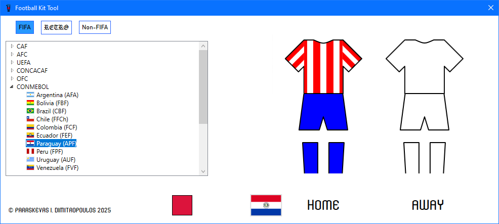

Football Kit Tool is more than a kit catalogue: it is the ultimate dream for football nostalgia lovers. It's a fully AI-free WPF desktop app for visually identifying the traditional home and away kits of national teams, split into three categories: FIFA members, retro, and non-FIFA teams.

Ever since I briefly worked with WPF at my current job, the framework kept piquing my curiosity, so much so that I decided to build my first personal application with it, rather than the more convenient WinForms. While looking for ideas, I remembered a side project of mine: a wiki of real and imaginary football kits. That got me thinking: how cool would it be to have an offline alternative? As an avid collector of football memorabilia, it was only natural that my first app would come from my hobby.

This post is about what happened next, and where it caught me offside.

Think of development as a team effort: the developer, alongside his thoughts, tools and sources, all pulling in the same direction. Now picture an application's development as a football match, with the IDE as the pitch, the framework as the opponent and the compiler as the referee, who blows the whistle on every foul and never takes a bribe. Whenever I say "we" from here on, I mean that team.

## Kick-Off: Meet the App

The app is still in pre-season, so there is no download or source code for now – screenshots will have to do.

Launching the app lands you on an empty stage: two blank kit outlines, accompanied by a list of confœderations on the left, a red square button on the bottom and three rectangular buttons across the top.

*The app's landing screen: a collapsed tree view on the left and two empty kits on the right.*

Each button corresponds to one of three categories: FIFA, Retro, and Non-FIFA, with Retro presented with its own, unique blackletter font as a discreet nod to the past. The neat part is that they come with sound: hovering over a category button plays the sound Pro Evolution Soccer 2008 makes when you move the marker in a menu, and clicking one plays the sound the game makes when you enter a mode or press a dialogue button. It's a minor detail, yet it makes the app feel like one of my favourite PES titles, the video game series that inspired my love for football kits.

By default, the FIFA category is selected, with its list containing FIFA-member associations/fœderations, organised by confœderation (CAF, AFC, UEFA, CONCACAF, OFC, and CONMEBOL) and visible when the corresponding node is expanded. Each country leaf on the tree view shows the country's flag, the country's name in English, and the acronym of its football association in parentheses, for example Hellas – commonly referred to as "Greece"; HFF stands for *Hellenic Football Fœderation*.

*The traditional kits of Hellas: all-white home and all-blue away. Hellas is a member of UEFA and, by extension, of FIFA.*

Clicking a country fills the kit outlines and labels them "HOME" and "AWAY", with the selected country's flag appearing in the bottom-left corner of the space.

*The kits of FR Yugoslavia: blue jersey, white shorts and red socks at home; white jersey, blue shorts and white socks away. FR Yugoslavia existed between 1992 and 2003, hence it was included in the Retro category.*

The red square close to the flag is the reset button: it empties the kits and hides the flag and labels, essentially operating as a *deselect* button.

*Christmas Island, an Australian external territory in the Indian Ocean, has played very few recorded matches, almost all of them in the Inter-Island Cup, a tournament contested with the neighbouring Cocos (Keeling) Islands on and off between 1994 and 2017. Their home kit is a green jersey with blue shorts and socks, while the away kit is all-white. Christmas Island is a member of neither FIFA nor the Oceanian Football Confœderation (OFC), which is why it sits in the Non-FIFA category.*

## VAR Check: The Reality of WPF

The second half kicked off with a rapid succession of "counter-attacks" that made it look like my plan had backfired… or so I thought.

Navigating through XAML is exhausting, especially when each team is a tree view item that is written across 10 lines, and that's just the tip of the iceberg. My build-up was calculated: small chunks of edits during each session, careful event handling from within the C# class accompanying the XAML file, testing each team to ensure everything is perfect – a harmonious cycle of steps that grew the code larger, yet at the same time helped me organise my functions and properly lay my plan out. But alas, a more experienced developer in my stead would have accounted for the "traps" hidden within the framework.

The first headache came early in the app's development, when I was planning out the kit display. My first instinct was to include real-life images, or designs digitally created by myself, either in Photoshop or with Mushriq's [Smart Shirt Designer 2](https://www.fmscout.com/a-smart-shirt-designer-2.html), one of the best tools for custom kit designs. While tempting, this would leave me with a significant amount of images taking up way too much space. Moreover, any such designs would most likely focus on details that would make the display a lot more technical. My goal was the creation of a simple, minimalistic, standalone app – and still is, as the app is under construction.

And then it hit me like one of Roberto Carlos' lethal free kicks: wiki. For those unfamiliar with the concept, sports kits on MediaWiki-based sites are displayed as vector templates filled with colours. At that point I had been working on a fantasy wiki project where I displayed football kits, just the way you see them in the app – so why not try to replicate what wiki sites do? That's where I met my second tight marker…

Image colourisation is not as straightforward as most people might think. You cannot simply take an image and recolour only its fill on the fly: a hue shift leaves a white fill white, and swapping pixels by hand leaves ragged edges. What I needed was a NuGet package. Thankfully, [SharpVectors](https://github.com/ElinamLLC/SharpVectors) by Elinam LLC was the perfect choice; all it required were the base .svg elements – and that's where the real trouble began.

As I started navigating the .svg colourisation, I realised that not all teams have plain jerseys. Starting from Africa in alphabetical order, when I reached Liberia, I suddenly discovered they have been playing in striped jerseys for many years. This only meant one thing: I had to include patterns, not just stripes, but anything that could affect the entire shirt – even the sleeves.

*Paraguay is one of many teams whose kits need patterns: here, vertical stripes run across the body and the sleeves. Traditionally, they play in a red-and-white striped jersey with blue shorts and socks, while their away kit is usually all-white.*

What I found particularly frustrating was the placement of the .svg files: each time I encounter a new pattern, I have to place it on a stack of hidden images that only become visible when the selected team uses that design. I imagined having a class that dynamically places a pattern on the fly, but I couldn't find a way to escape the coexistence of all images on top of each other to produce the dream result. While inelegant, the solution itself truly encompasses simplicity, since the centralisation of all files makes managing them easier and all relevant XAML lines are clustered together.

Writing each team's event handler in C# was actually the fun part, as I ended up formalising a structure that is easily copied and pasted over and over again. Even the overloads of my colourisation method were fun to design. On top of that, as the `Color` struct is the backbone of this entire operation, I feel deeply pleased with my idea of assigning colours to constants that I can use multiple times, without having to always write "`Colors.[colour name]`".

Every hurdle felt like my whole project was under VAR review. The app did catch me offside a few times, but every single VAR check ended the same way: the plan was solid; all I had to do was adapt and rise to the challenge. Each time, I felt the sigh of relief every football fan experiences when the referee points to the opponents' penalty spot after a lengthy VAR check.

## The Final Whistle: What This Project Taught Me

After hustling for the proverbial 90 minutes, we are now in stoppage time, anxiously waiting for the sweet triple sound of the referee's whistle. As I stand on the pitch, ready for the dying moments of this thrilling match, I ponder: what has this adventure taught me? Honestly, the biggest lesson is that a crude solution can still be the right one. A stack of hidden images sitting on top of each other is not what I had imagined, yet it helps me keep every pattern in one place, turning each new entry into a simple matter of copying a structure I've grown fond of.

The arena is quiet, the fans are breathless, the manager's eyes are glimmering… A nasty charge brings my teammate down, face-first. Free kick: a few moments gained and a perfect excuse for gathering my thoughts. While the warriors around me are tense, at each other's throats, I ask myself: was WPF worth it? For a project like this one, yes, but not in general: the combination of XAML and C# is far more complicated than WinForms, and the mere volume of XAML lines the app has accumulated is the price I paid. If I had to do it all over again, the first thing I would redo is the team selection logic. Instead of adding every team to a tree view by hand, I would store all the information in a data grid and add filters to narrow the entries down.

Football Kit Tool is still under construction: first I will finish the national teams, then move on to a "Club Mode" that replaces the lists of national teams with clubs, working exactly the same way. With that many more entries, Club Mode is where the data grid and filters idea may finally emerge like a "super sub": the player who comes off the bench late in the game, yet makes all the difference.

Our only hope is to avoid extra time at all costs: the winning goal will signify the full completion of the project and a huge win for me, the developer, as this application is my first ever attempt to write my own app outside of environments such as [Scratch](https://scratch.mit.edu/). While we haven't reached full time, this post has come to an end. I will discuss Football Kit Tool's completion in a future post – but the next post will be about a different project.