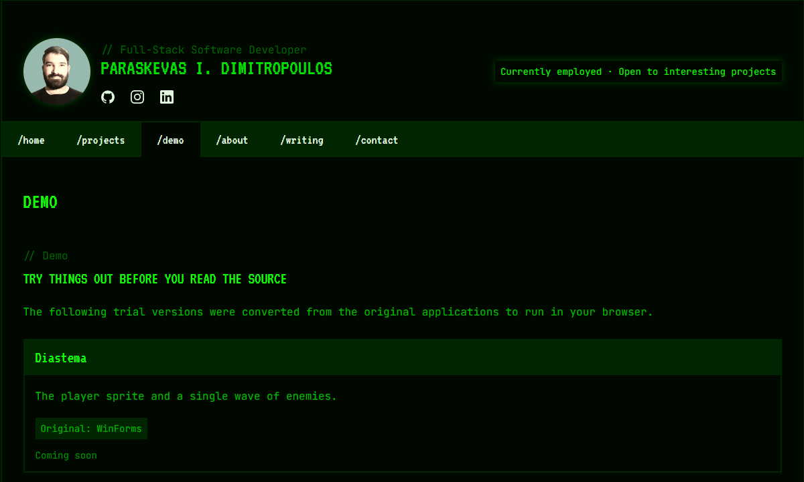
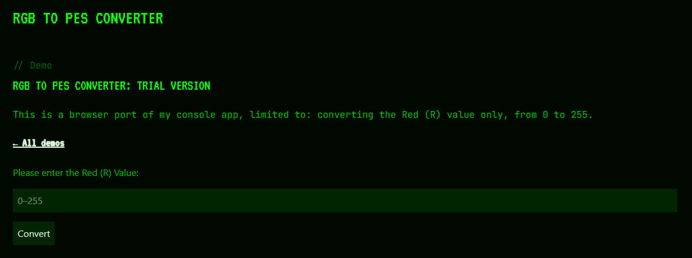

Describing my projects and how they came to be is the very core of my dev blog – and yet it feels empty, as if something is missing. This is why I am proud to introduce [demo](https://pdimitro.pages.dev/demo/), the newest section of my blog. In this article, I will present the section and walk you through its current content and upcoming additions.

## Overview

At the time of writing, my dev blog lists six projects in the corresponding [section](https://pdimitro.pages.dev/projects/). One of them – Armistice, my thesis – is a full game that needs optimisation, so a demonstration is not a priority for the foreseeable future. Instead, I will give you a glimpse of the other five projects. For now, only one demo is live – [RGB to PES Converter](https://pdimitro.pages.dev/demo/rgb-to-pes/) – while the other four are described below and will be added in due course.

## The Demo Section

The section contains a list of demos. Each entry features a brief description, the project's original format, and a status indicator. Think of it as a reiteration of the projects section, although, as noted above, I am not planning to release demo versions for all of my projects.

When a demo is released, its status indicator is changed from the label *Coming soon* to a *Launch demo* link, which takes the reader to the page hosting the demo.

## How the Demos Work

Since the projects listed below were originally released as desktop or console applications, I had to port them to run in the browser without compromising the integrity of the end product, while ensuring a degree of compatibility with Astro – the framework which my dev blog is built upon.

For example, to port RGB to PES Converter, I had to adapt the converter function, originally written in C#, into a TypeScript file that Astro then runs. The script works under the hood, turning the 256-level input into the same output that the original app produces.

### Diastema (Coming soon)

Diastema is a video game inspired by the classic arcade title Space Invaders. The trial version will feature just one wave of enemies.

### Football Kit Tool (Coming soon)

Football Kit Tool is a desktop app that contains a library of national football teams and their respective traditional home and away kits; you can read all about the app in my [previous article](https://pdimitro.pages.dev/blog/game-of-two-halves-first-wpf-app/). The demo, which will be released at a later date, will feature only three teams – one per category (FIFA, Retro, Non-FIFA).

### FutDraw (Coming soon)

FutDraw is a desktop utility that splits a list of football teams into either groups or the branches of a knock-out tree, depending on the chosen mode. The trial version will feature two options: 'Group Stage – 8 teams' and 'Knock-out Stage – 4 teams'.

### PES Clubs (Coming soon)

PES Clubs is a desktop app that shows how football teams were named in Pro Evolution Soccer when they were unlicensed, along with their fictional logos. All rights are reserved by Konami Computer Entertainment Japan. The trial version will be limited to twenty teams.

### RGB to PES Converter

RGB to PES Converter is a tool for turning 256-level colour values into the 64-level system featured in the final eight Pro Evolution Soccer instalments; introduced in PES 2014, it remained in place until PES 2021, the final entry of the series before the transition to eFootball. In this demo, users can enter a 256-level Red (R) value, between 0 and 255, and convert it to the closest 64-level value.

## Afterthoughts

Developing applications is a healthy mix of fun and labour – I honestly take pleasure in the challenges that arise while toiling away in the IDE of my choice. What I enjoy most, however, is shortening the code behind the end product and turning it into a trial version – an even greater puzzle to solve. Demos are useful, as they serve primarily to gather feedback from users before the release of the full product.

Although I have not settled on the order of release, the remaining demos will follow before long. Your feedback matters, and I'd love to hear your opinion or suggestions – just head over to my [contact page](https://pdimitro.pages.dev/contact/).
