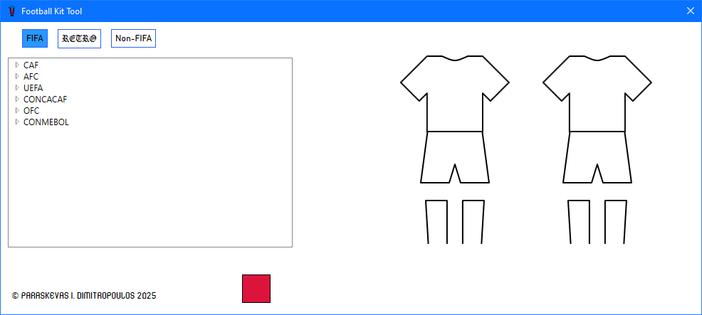
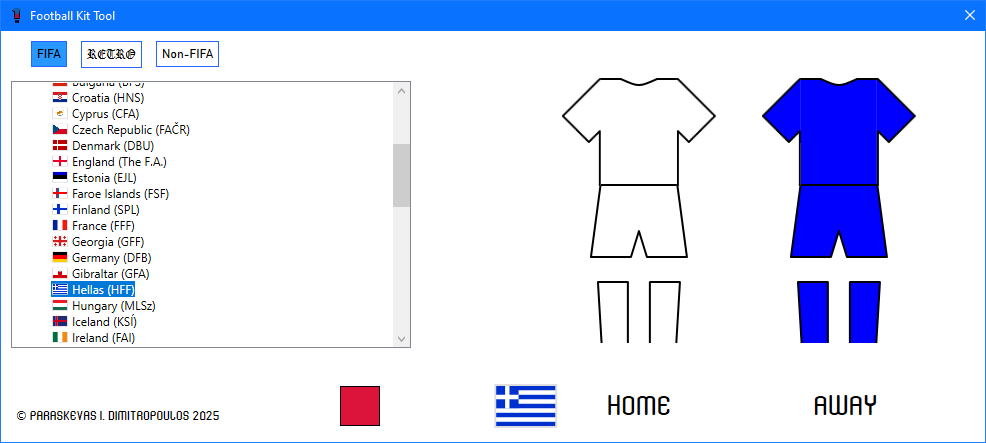
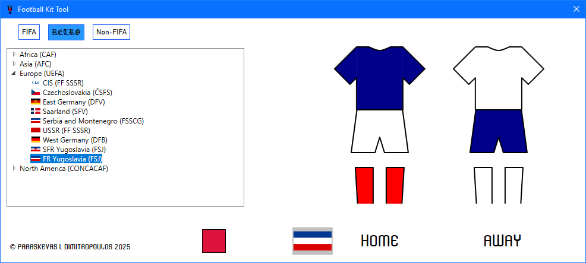
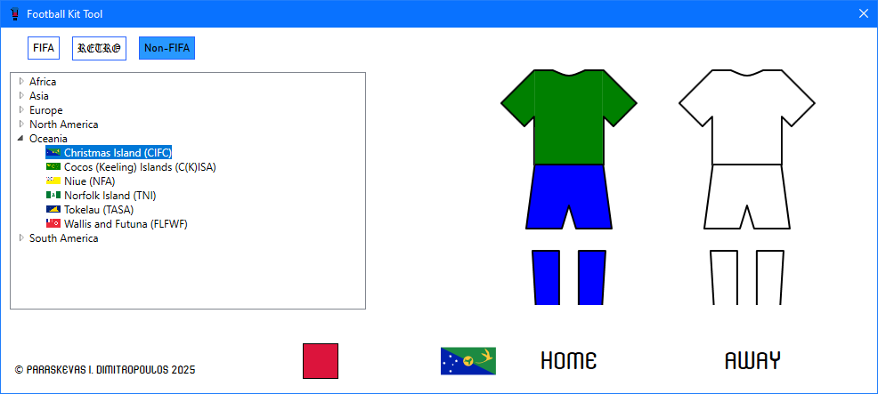

Football Kit Tool is more than a kit catalogue: it is the ultimate dream for football nostalgia lovers. It's a fully AI-free WPF desktop app for visually identifying the traditional home and away kits of national teams, split into three categories: FIFA members, retro, and non-FIFA teams.

Ever since I briefly worked with WPF at my current job, the framework kept piquing my curiosity, so much so that I decided to build my first personal application with it, rather than the more convenient WinForms. While looking for ideas, I remembered a side project of mine: a wiki of real and imaginary football kits. That got me thinking: how cool would it be to have an offline alternative? As an avid collector of football memorabilia, it was only natural that my first app would come from my hobby.

This post is about what happened next, and where it caught me offside.

## Kick-Off: Meet the App

Launching the app lands you on an empty stage: two blank kit outlines, accompanied by a list of confœderations on the left, a red square button on the bottom and three rectangular buttons across the top.

Each button corresponds to one of three categories: FIFA, Retro, and Non-FIFA, with Retro presented with its own, unique blackletter font as a discreet nod to the past. The neat part is that they come with sound: hovering over a category button plays the sound Pro Evolution Soccer 2008 makes when you move the marker in a menu, and clicking one plays the sound the game makes when you enter a mode or press a dialogue button. It's a minor detail, yet it makes the app feel like one of my favourite PES tites, the video game series that inspired my love for football kits.

By default, the FIFA category is selected, with its list containing FIFA-member associations/fœderations, organised by confœderation (CAF, AFC, UEFA, CONCACAF, OFC, and CONMEBOL) and visible when the corresponding node is expanded. Each country leaf on the tree view shows the country's flag, the country's name in English, and the acronym of its football association in parentheses, for example Hellas (HFF).

By clicking on a country, the kit outlines are filled and labeled as "HOME" and "AWAY", with the selected country's flag now appearing on the bottom left corner of the space.

The red square close to the flag is the reset button: it empties the kits and hides the flag and labels, essentially operating as a *deselect* button.

## VAR Check: The Reality of WPF

Navigating through XAML is exhausting, especially when each team is a tree view item that is written across 10 lines; and that's just the tip of the iceberg. My build-up was calculated: small chunks of edits during each session, careful event handling from within the C# class accompanying the XAML file, testing each team to ensure everything is perfect – a harmonic cycle of steps that grew the code larger, yet at the same time helped me organise my functions and properly lay my plan out. There was just one major flaw in my plan: the "traps" hidden within the framework.

The first headache came when I realised early on that not all teams have plain jerseys; starting from Africa in alphabetic order, when I reached Liberia, I suddenly realised they have been playing in striped jerseys for many years. This only meant one thing: I had to include patterns, not just stripes, but anything that could affect the entire shirt – even the sleeves.

## The Final Whistle: What This Project Taught Me

.
